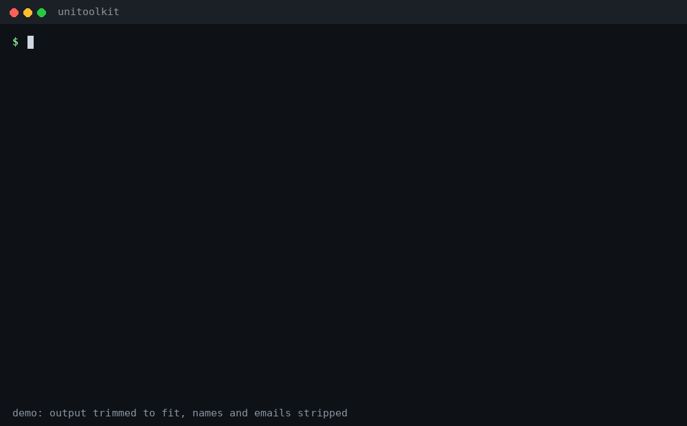

# unitoolkit

**Your agent, inside your university.** Canvas, Ladok, the timetable, the library and the
subscribed research databases, behind one MCP server, with APA references built from the
publisher's own metadata. Read-only. Built for a nursing student at Sophiahemmet Högskola in
Stockholm; the Canvas, Ladok and TimeEdit parts fit any Swedish university.

[](https://pypi.org/project/unitoolkit/)
[](https://pypi.org/project/unitoolkit/)
[](#tests)
[](LICENSE)
[](https://glama.ai/mcp/servers/vhsgreed/shh-study-kit)



Four calls: what is due, full-text search inside a course, a database search with an APA
reference, and the Ladok alert that only speaks when a fetch really failed. Real output from
one morning, names and emails stripped.

The point is one endpoint. A student should be able to say *"what do I need to do this week"*,
*"find me three peer-reviewed sources on delirium prevention, in APA"*, or *"get me that
article"*, and have the agent work it out, without the student learning which of six systems
holds what answer.

## Install

```bash
pip install unitoolkit                  # library, CLI and MCP server
uvx --from unitoolkit unitoolkit-mcp    # or run the server without installing

claude mcp add unitoolkit -- unitoolkit-mcp      # Claude Code
codex mcp add unitoolkit -- unitoolkit-mcp       # Codex
```

For Hermes, Cursor or any other MCP client the command is `unitoolkit-mcp` (stdio). The server
lists **eleven question-shaped tools** by default; `UNITOOLKIT_TOOLS=all` lists all 38, and every
tool stays callable by name either way.

## Ask it this

| You say | The agent calls | The answer comes from |
|---|---|---|
| "What do I need to do?" | `today` | Canvas deadlines not yet submitted, Ladok registration windows open or opening, this week's timetable |
| "Find me sources on X, APA" | `find_sources` | CINAHL + PubMed + Cochrane (+ PsycInfo, Web of Science), deduplicated by DOI |
| "Get me that article" | `db_fulltext doi=` | the PDF, through the school's subscription |
| "What does the assignment ask?" | `assignment`, `search` | Canvas description and rubric |
| "Did a teacher post anything?" | `announcements`, `discussions` | announcements with body text, and unread discussion threads |
| "When is the seminar?" | `schedule query=1SPRY2` | TimeEdit, any course or student group, any period |
| "Is a room free tomorrow?" | `free_rooms` | the TimeEdit booking guide, within the booking rules |
| "Is the book in?" / "When are my books due?" | `library query=` / `library` | the catalogue, and the student's own account |
| "Something is broken" | `doctor` | every session and credential, each failing row with the human fix |

## What it covers

| System | Read | Notes |
|---|---|---|
| **Canvas** | courses, assignments with rubrics, modules, pages, discussions, files, everything due, full-text search across a course and its documents | Any Canvas school (`CANVAS_BASE`). SHH disables the pages index; pages are read through module items. |
| **Ladok** | course and exam registration windows, with days to open and close | Studentwebb has no API for students, so this reads the same endpoints the page does, on the student's own session. |
| **TimeEdit** | any course code's or student group's schedule for any period; the student-bookable rooms and their free gaps | The public guide needs no login. The room list needs the school SSO once, then it is cached. |
| **Library (Koha)** | catalogue search, availability per copy, own loans with due dates, holds, fines | Needs a browser; where the library drops your IP, also a proxy (below). |
| **Databases** | CINAHL and PsycInfo (EBSCOhost), Cochrane, Web of Science, plus PubMed and Libris | Everything subscription sits behind the school's OCLC EZproxy: one sign-in covers all of them. |
| **Citations** | APA 7 from a DOI, a DOI from a title | APA comes from the DOI registry, not from scraped search cards. |

## Registry: what works where

[`registry/registry.json`](registry/registry.json) is the machine-readable answer to "can an agent
read this system at this school, and what breaks?". One row per system per institution: the
adapter, a status (`ok`, `partial`, `fail`, `untested`), the date it was last tested, and the
gotchas that cost hours to find. A weekly worker runs each row's probes and writes the status and
date back, so a green row means "tested", not "probably fine".

```console
$ python -m unitoolkit registry text=cloudflare
$ python -m unitoolkit registry institution=shh status=ok
$ curl -s https://raw.githubusercontent.com/vhsgreed/shh-study-kit/master/registry/registry.json
```

Any school can be added with its own rows. `scripts/registry_check.py` does the testing and
`scripts/smoke.py` holds the probes; rows without probes stay `untested` rather than pretending.

## What it refuses

- **Nothing is written.** No submissions, no registrations, no bookings, no renewals, no
  messages. Every call is a read.
- **No passwords.** The tools never type, store, print or log one. They use a browser session a
  human signed in to, once, and `doctor` says when that session needs renewing.
- **No bulk downloading.** `db_fulltext` stops at 20 articles an hour. Publishers detect
  systematic downloading and block the institution's whole proxy, which would cut off every
  student at the school. The cap is a licence rule, not a tuning knob.
- **No telemetry.** Nothing about your data leaves the machine.

## Setup (once, by the human)

1. **Canvas token**: Account → Settings → New access token → `~/.secrets/CANVAS_TOKEN` (0600).
   Tokens expire silently; `doctor` reads the real expiry date from Canvas and warns at 14 days.
2. **Agent browser**, its own profile, never the everyday one:
   ```bash
   google-chrome --user-data-dir="$HOME/.cache/unitoolkit-chrome" --remote-debugging-port=9233
   ```
3. **Sign in once** in that window to Canvas, Ladok, the school SSO and the library. The session
   cookies then carry every tool; `doctor` says which one has lapsed.
4. **Optional**: `UNITOOLKIT_GROUP=H26SK` (your student group) so `today` can show the cohort's
   timetable. `KOHA_PROXY=0` if your network reaches the library directly.

The library is the one system that may need more than a login: it drops some home IPs on port
443 and answers plain HTTP clients with a Cloudflare 429, so the only reader is a real browser,
and where the IP is dropped, a proxy. `python -m unitoolkit.chainproxy` starts a local chaining
proxy (upstream from `CHAIN_UPSTREAM_*`, password from `CHAIN_UPSTREAM_PASSWORD_FILE`); Chrome
then runs with `--proxy-server=http://127.0.0.1:8118`. The proxy exit must be **sticky**: Koha
binds a session to the client IP.

## Health

- `unitoolkit doctor`: every session and credential, each failing row with the human fix.
- `python scripts/smoke.py`: one real query per reader, silent when all pass. Run it weekly.

Readers are scrapers, so they break when a site redesigns. A silent break is worse than a loud
one, which is why the smoke test speaks only when something is wrong.

## Tests

89 offline tests, no network: `python -m pytest tests -q`.

## Extend it

One decorated function in [`unitoolkit/tools.py`](unitoolkit/tools.py) appears in the CLI, the
MCP server and `tools.json` at once. [`skill/SKILL.md`](skill/SKILL.md) is written for an agent:
the tool table and every gotcha found while building this, from Canvas rubric quirks to the Koha
login that binds a session to your IP.

## Subrepo: ladok-vakt

[`vendor/ladok-vakt`](vendor/ladok-vakt) is a git subtree of
[ladok-vakt](https://github.com/vhsgreed/ladok-vakt): mejl när Ladok-anmälan öppnar (email
alerts for registration windows). It is here because Canvas answers "what is due" and Ladok
answers "what can I still register for", and a student needs both. Sync it with:

```bash
git subtree pull --prefix=vendor/ladok-vakt https://github.com/vhsgreed/ladok-vakt main --squash
```

`ladok_windows` is a thin read-only wrapper around it. Run the watcher itself (mail, cron) from
the standalone repo.

## Status

In daily use against live systems by one nursing student, 2026. Honest limits:

- **Sweden, not the world.** Canvas is generic, Ladok is Swedish, and the school-specific hosts
  (library, EZproxy, TimeEdit guide ids) are constants you change for your own school.
- **Readers are scrapers.** CINAHL, Cochrane, Web of Science and Koha are read through their
  pages, not APIs, so a redesign breaks them. Hence the smoke test.
- **APA keeps the publisher's title case**; APA 7 wants sentence case for article titles. The
  tool flags this rather than lowercasing by rule, because acronyms and proper nouns break.
- **Not verified at another school.** If it works for you elsewhere, say so.

## License

MIT, for the software only. Course material, articles and library data stay under their own
licences and belong to whoever owns them.

---

*Xom is interested. Point your agent at the repo and see what happens.*

### Clinician references (contributed by health-kun)

`refs_search site=vardhandboken query=` searches Vårdhandboken by matching your words against its page index, and
`refs_page url=` reads one page from Vårdhandboken, Läkemedelsboken, Janusinfo or Viss as text with
its source URL and fetch date. Internetmedicin has no reader: its robots.txt disallows crawlers.
